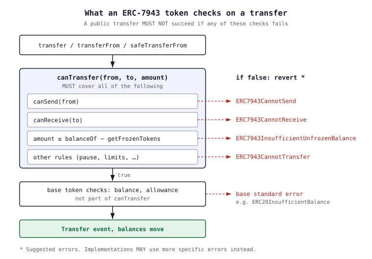
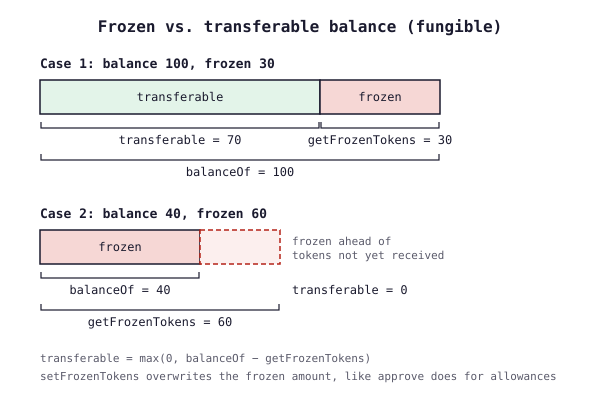

## Introduction {#introduction}

ERC-7943, also known as **uRWA** (Universal Real World Asset Interface), defines a common way for tokens representing real-world assets (securities, real estate, commodities, private credit) to expose their regulatory compliance rules on-chain.

Real-world assets often come with requirements that plain tokens do not have: only KYC-cleared wallets may hold them, assets can be frozen under legal obligation, and issuers may need to move tokens back from a holder without their signature. Every issuer that faces these rules invents its own functions, so wallets, exchanges and DeFi protocols must study each token individually before integrating it.

ERC-7943 standardizes that surface: four view functions to ask whether an account or a transfer is allowed and how many tokens are frozen, and two privileged functions to freeze tokens or enforce a transfer. It sits on top of an existing base token ([ERC-20](/developers/docs/standards/tokens/erc-20/), [ERC-721](/developers/docs/standards/tokens/erc-721/), [ERC-1155](/developers/docs/standards/tokens/erc-1155/) or [ERC-6909](https://eips.ethereum.org/EIPS/eip-6909)) and deliberately does **not** prescribe how the underlying compliance logic works. An allowlist, a claim-registry system, a zero-knowledge proof system or an oracle-based check are all valid backends as long as the contract implements the six standard functions.

## Prerequisites {#prerequisites}

To get the most out of this page, you should be familiar with:

- [Token standards](/developers/docs/standards/tokens/) and [ERC-20](/developers/docs/standards/tokens/erc-20/)
- [ERC-165](https://eips.ethereum.org/EIPS/eip-165) interface detection
- [Real-world assets](/real-world-assets/) as a use case

## Why a shared compliance layer {#why-a-shared-compliance-layer}

Compliant tokens are everywhere, but integrators deal with them one at a time. Before sending a regulated token, a protocol has to answer questions that no base standard asks:

- Is the sender allowed to transfer at all?
- Is the receiver allowed to hold this asset?
- Are some of the sender's tokens currently frozen?
- Could the issuer move these tokens without the holder's consent?

Without a shared interface, the answer is "read this token's source code". With ERC-7943, the answer is always the same six functions, no matter the asset class or the compliance engine behind it. This is what makes compliant tokens composable with DeFi: a lending market, a decentralized exchange or a settlement contract can apply one integration to every ERC-7943 token.

The standard is intentionally minimal. It defines the interaction surface, not a policy language. Issuers keep full freedom over who is allowed, why, and how rules are enforced; integrators get a uniform way to ask.

## How it works {#how-it-works}

An ERC-7943 token extends one base token standard and adds two groups of functions:

| Group | Functions | Who calls them |
|-------|-----------|----------------|
| Compliance checks | `canSend`, `canReceive`, `canTransfer`, `getFrozenTokens` | Anyone (wallets, protocols, frontends) |
| Enforcement | `setFrozenTokens`, `forcedTransfer` | Only privileged roles (issuer, compliance agent) |

The compliance checks are `view` functions. `canSend`, `canReceive` and `canTransfer` MUST NOT revert and MUST NOT change state, so they are safe to call ahead of time to predict whether a transfer will succeed. The token's own transfer functions MUST enforce the same rules.



A public transfer of an ERC-7943 token MUST NOT succeed unless `canTransfer` returns `true`. `canTransfer` itself MUST include the `canSend` check on the sender, the `canReceive` check on the receiver, and a check that the amount does not exceed the sender's unfrozen balance, plus any other permissioned rule such as a pause. It does not cover balance or allowance checks, which stay with the base token standard. When a check fails, the standard suggests a matching `ERC7943*` error, but implementations may use more specific errors instead.

The same rules extend to minting and burning:

- **Minting** by anyone MUST respect `canReceive` on the recipient. Minting by a privileged role SHOULD respect it, but MAY bypass it.
- **Burning** by the holder MUST respect `canSend`, `canTransfer` and the unfrozen balance. Burning by a privileged role MAY skip the `canSend` check and MAY burn frozen tokens, in which case the token MUST reduce the frozen amount and emit `Frozen` first.

### Interface detection {#interface-detection}

ERC-7943 requires [ERC-165](https://eips.ethereum.org/EIPS/eip-165). A compliant contract MUST return `true` from `supportsInterface` for the id of each variant it implements:

| Variant | Interface | `interfaceId` |
|---------|-----------|---------------|
| Fungible | `IERC7943Fungible` | `0x3edbb4c4` |
| Non-fungible | `IERC7943NonFungible` | `0xbf1ef5fe` |
| Multi-token | `IERC7943MultiToken` | `0x41c4fbad` |

## Interfaces {#interfaces}

A contract implements the variant that matches its base token. The three variants share the same semantics; they differ in granularity (amounts, token ids, or both).

### IERC7943Fungible {#ierc7943fungible}

For ERC-20-based assets.

#### canSend {#cansend}

```solidity
function canSend(address account) external view returns (bool allowed)
```

Returns whether `account` is allowed to send tokens under the token's rules. This is where allowlist, KYC/KYB or AML state is typically read. It is an account-level check: it MUST NOT depend on the counterparty or the amount.

#### canReceive {#canreceive}

```solidity
function canReceive(address account) external view returns (bool allowed)
```

Returns whether `account` is allowed to receive tokens. Like `canSend`, it is an account-level check. The two are separate so that an account can be blocked in one direction only, for example allowed to send but not to receive after its KYC expires.

#### canTransfer {#cantransfer}

```solidity
function canTransfer(address from, address to, uint256 amount) external view returns (bool allowed)
```

The transfer-level check. It MUST return `false` if `canSend(from)` or `canReceive(to)` is false, if `amount` exceeds the unfrozen balance of `from`, or if any other permissioned rule (a pause, a transfer limit, a counterparty restriction) would block the transfer.

It MUST NOT return `false` because of balance or allowance checks, which belong to the base token. A `true` result therefore does not guarantee that the transfer succeeds: the sender still needs enough balance and, for `transferFrom`, enough allowance.

#### getFrozenTokens {#getfrozentokens}

```solidity
function getFrozenTokens(address account) external view returns (uint256 amount)
```

Returns how many tokens of `account` are currently frozen. The value MAY exceed the account's balance (freezing ahead of funds that will arrive), so integrators should clamp at zero when computing an available balance.



#### setFrozenTokens {#setfrozentokens}

```solidity
function setFrozenTokens(address account, uint256 amount) external returns (bool result)
```

Overwrites the frozen amount for `account`, similar to how `approve` overwrites an allowance. Only privileged roles may call it, and it MUST allow freezing more than the account currently holds. The token MUST NOT let the account transfer the frozen portion. Emits `Frozen`.

#### forcedTransfer {#forcedtransfer}

```solidity
function forcedTransfer(address from, address to, uint256 amount) external returns (bool result)
```

Moves tokens without the holder's signature, for regulatory enforcement or recovery scenarios. Only privileged roles may call it. It MUST emit the base standard's regular transfer event(s) and a `ForcedTransfer` event.

When a single party holds the privileged role, `forcedTransfer` MAY bypass `canTransfer`, although it SHOULD still check `canReceive` on the recipient. If it bypasses the checks and moves frozen tokens, it MUST first reduce the frozen amount and emit `Frozen` before the transfer event. When several parties share the privileged role, it SHOULD run the `canTransfer` checks and SHOULD NOT bypass the frozen amount.

### IERC7943NonFungible {#ierc7943nonfungible}

For ERC-721-based assets. Same semantics at token granularity:

```solidity
function forcedTransfer(address from, address to, uint256 tokenId) external returns (bool result)
function setFrozenTokens(address account, uint256 tokenId, bool frozenStatus) external returns (bool result)
function getFrozenTokens(address account, uint256 tokenId) external view returns (bool frozenStatus)
function canTransfer(address from, address to, uint256 tokenId) external view returns (bool allowed)
```

`canSend` and `canReceive` are unchanged. Freezing is a per-token boolean instead of an amount, and `getFrozenTokens` MAY return `true` even if the account does not hold the token.

### IERC7943MultiToken {#ierc7943multitoken}

For ERC-1155 and ERC-6909-based assets. Combines both dimensions:

```solidity
function forcedTransfer(address from, address to, uint256 tokenId, uint256 amount) external returns (bool result)
function setFrozenTokens(address account, uint256 tokenId, uint256 amount) external returns (bool result)
function getFrozenTokens(address account, uint256 tokenId) external view returns (uint256 amount)
function canTransfer(address from, address to, uint256 tokenId, uint256 amount) external view returns (bool allowed)
```

## Events {#events}

### ForcedTransfer {#forcedtransfer-event}

```solidity
event ForcedTransfer(address indexed from, address indexed to, uint256 amount)
```

Emitted by `forcedTransfer`, alongside the base standard's regular transfer event. The non-fungible variant uses `uint256 indexed tokenId` instead of `amount`, and the multi-token variant adds `uint256 indexed tokenId` before `amount`.

Because the regular transfer event is always emitted too, indexers that track balances from transfer events stay correct. Use `ForcedTransfer` to label a transfer as an enforcement action, not to update balances a second time.

### Frozen {#frozen-event}

```solidity
event Frozen(address indexed account, uint256 amount)
```

Emitted on every `setFrozenTokens` call, and whenever a forced transfer or a privileged burn reduces the frozen amount. It carries the new frozen value, not the change. The non-fungible variant uses `uint256 indexed tokenId, bool indexed frozenStatus`, and the multi-token variant uses `uint256 indexed tokenId, uint256 amount`.

## Errors {#errors}

ERC-7943 defines four custom errors, named following the [ERC-6093](https://eips.ethereum.org/EIPS/eip-6093) conventions:

| Error | Meaning |
|-------|---------|
| `ERC7943CannotSend(address account)` | Sender failed `canSend` |
| `ERC7943CannotReceive(address account)` | Receiver failed `canReceive` |
| `ERC7943CannotTransfer(address from, address to, ...)` | The transfer rules rejected this specific transfer |
| `ERC7943InsufficientUnfrozenBalance(address account, ...)` | Balance is sufficient but the unfrozen balance is not |

Using these errors is optional: implementations MAY replace them with more specific errors. The exception is a frozen-balance failure, where `ERC7943InsufficientUnfrozenBalance` SHOULD be used. If the amount exceeds the whole balance, the base standard's own error applies instead.

## Integrating with ERC-7943 tokens {#integrating-with-erc-7943-tokens}

If you are building a protocol, wallet or marketplace that must handle compliant tokens:

1. **Detect first.** Call `supportsInterface` for the variant id. If it returns false, you are dealing with a plain token (or a custom scheme) and should apply your own fallback.
2. **Check before acting.** Call `canTransfer(from, to, amount)` before quoting or executing, and check balance and allowance separately. Treat `false` as "currently blocked", not "permanently blocked": compliance state changes.
3. **Call from the right context.** The checks MAY depend on `msg.sender`, the block timestamp or the block number. A check run from a frontend can return a different result than the same check run from your contract at execution time.
4. **Handle reverts anyway.** The state behind the checks can change between your check and your transaction, and the revert errors are not guaranteed to be the `ERC7943*` ones.
5. **Compute available balance.** For fungible tokens, the transferable balance is `balanceOf - getFrozenTokens`, clamped at zero. Multi-token contracts apply the same formula per `tokenId`. For non-fungible tokens, a token is transferable only if `getFrozenTokens(account, tokenId)` returns `false`.
6. **Surface enforcement.** Index `ForcedTransfer` and `Frozen` so users can see why a balance changed or became unavailable without their action.

## Security considerations {#security-considerations}

- **Privileged functions are the attack surface.** `forcedTransfer` and `setFrozenTokens` can move or lock users' assets. Access control design (roles, multisig, timelocks) is left to the issuer and deserves the same scrutiny as the token itself.
- **Front-running.** Like `approve` in ERC-20, the two privileged functions can be observed in the mempool and front-run. A holder may, for example, try to move funds before a freeze lands. When several privileged actors can freeze, implementations MAY add extensions that set the frozen amount conditionally or by delta to avoid overwriting each other.
- **Frozen can exceed balance.** The standard allows freezing more than an account owns today. UIs should clamp and label this clearly.
- **Hooks and reentrancy.** On ERC-721 (`onERC721Received`) and ERC-1155 (`onERC1155Received`), receiver hooks run during transfers, including forced transfers. Implementers should follow checks-effects-interactions, update frozen state before the transfer, and consider reentrancy guards.

## Reference implementations {#reference-implementations}

- [ERC-7943 reference contracts](https://github.com/ethereum/ERCs/tree/master/assets/erc-7943/contracts) for ERC-20, ERC-721 and ERC-1155 (educational, not audited)
- [OpenZeppelin `ERC20uRWA`](https://github.com/OpenZeppelin/openzeppelin-community-contracts/blob/master/contracts/token/ERC20/extensions/ERC20uRWA.sol) in the OpenZeppelin community contracts ([docs](https://docs.openzeppelin.com/community-contracts/api/token))
- [CMTAT](https://github.com/CMTA/CMTAT), the CMTA security token framework, with an [ERC-7943 integration guide](https://github.com/CMTA/CMTAT/blob/master/doc/technical/erc-7943-uRWA-integration.md)
- [Polymesh ERC-7943 precompiles](https://github.com/PolymeshAssociation/Polymesh/tree/develop/pallets/precompiles) for fungible and non-fungible assets

## Further reading {#further-reading}

- [EIP-7943: uRWA - Universal Real World Asset Interface](https://eips.ethereum.org/EIPS/eip-7943)
- [EIP-6093: Custom errors for commonly-used tokens](https://eips.ethereum.org/EIPS/eip-6093)
- [ERC-7943 discussion on Ethereum Magicians](https://ethereum-magicians.org/t/erc-universal-rwa-interface/23972)
