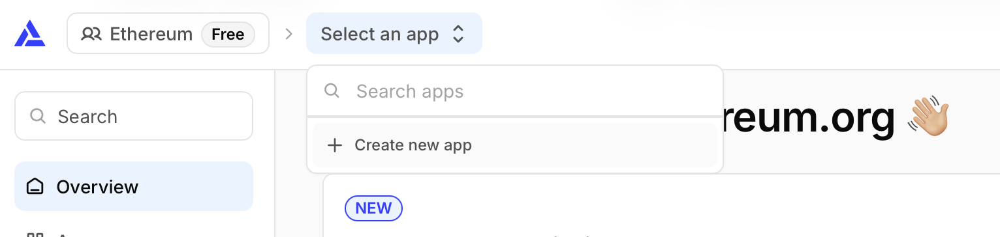
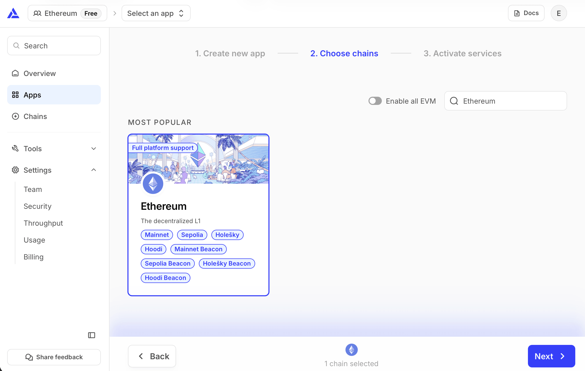
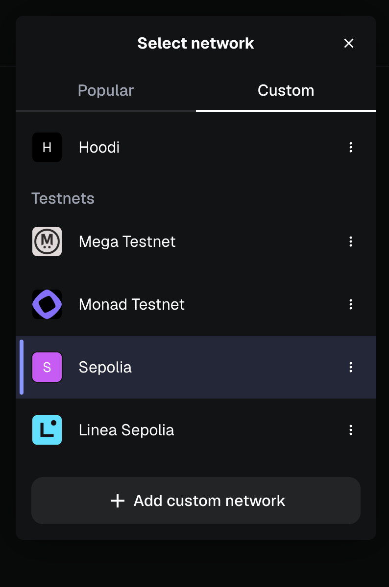
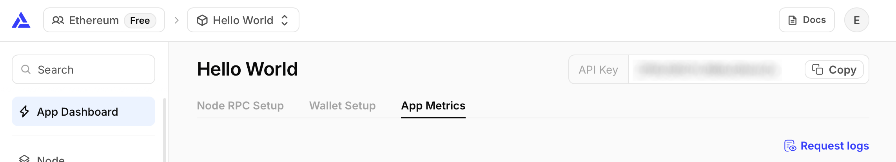
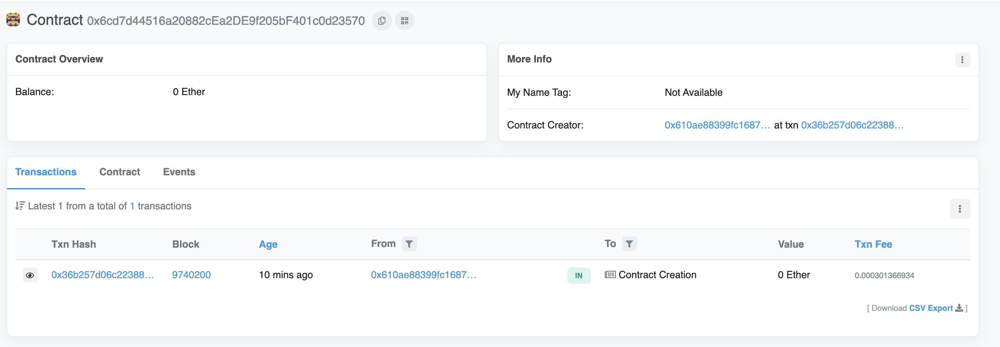
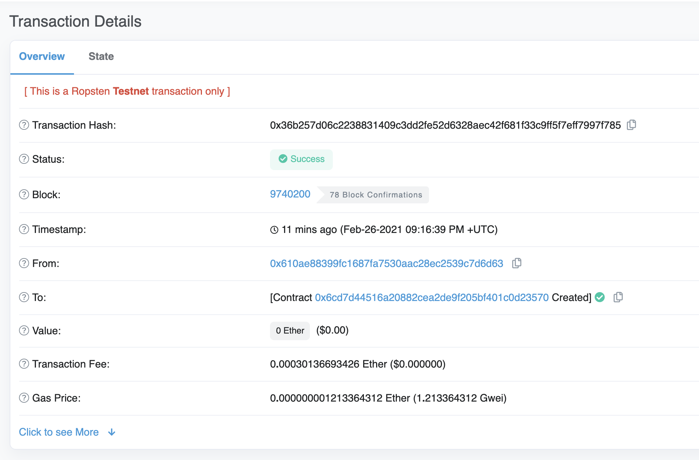

If you are new to blockchain development and don’t know where to start, or if you just want to understand how to deploy and interact with smart contracts, this guide is for you. We will walk through creating and deploying a simple smart contract on the Sepolia test network using a virtual wallet [MetaMask](https://metamask.io/), [Solidity](https://docs.soliditylang.org/), [Hardhat](https://hardhat.org/), and [Alchemy](https://www.alchemy.com/eth) (don’t worry if you don’t understand what any of this means yet, we will explain it).

Once your contract is deployed, you can [build a user interface for it](/developers/tutorials/creating-a-wagmi-ui-for-your-contract/).

If you have questions at any point feel free to reach out in the [Alchemy Discord](https://discord.gg/gWuC7zB)!

## Step 1: Connect to the Ethereum network {#step-1}

There are many ways to make requests to the Ethereum chain. For simplicity, we’ll use a free account on Alchemy, a blockchain developer platform and API that allows us to communicate with the Ethereum chain without having to run our own nodes. The platform also has developer tools for monitoring and analytics that we’ll take advantage of in this tutorial to understand what’s going on under the hood in our smart contract deployment. If you don’t already have an Alchemy account, [you can sign up for free here](https://dashboard.alchemy.com/signup).

## Step 2: Create your app (and API key) {#step-2}

Once you’ve created an Alchemy account, you can generate an API key by creating an app. This will allow us to make requests to the Sepolia test network. If you’re not familiar with testnets, check out [this page](/developers/docs/networks/).

1.  Navigate to the "Create new app" page in your Alchemy Dashboard by selecting "Select an app" in the nav bar and clicking "Create new app"



2. Name your app “Hello World”, offer a short description, and choose a use case, e.g., "Infra & Tooling." Next, search for "Ethereum" and select the network.



3. Click "Next" to proceed, then “Create app” and that’s it! Your app should appear in the nav bar dropdown menu, with an API Key available to copy.

## Step 3: Create an Ethereum account (address) {#step-3}

We need an Ethereum account to send and receive transactions. For this tutorial, we’ll use MetaMask, a virtual wallet in the browser used to manage your Ethereum account address. More on [transactions](/developers/docs/transactions/).

You can download MetaMask and create an Ethereum account for free [here](https://metamask.io/download). When you are creating an account, or if you already have an account, make sure to switch over to the "Sepolia" test network using the network dropdown menu (so that we’re not dealing with real money).

If you do not see Sepolia listed, open the menu in the top right corner, select "Networks", and toggle "Show test networks" on at the bottom of the network list (see [MetaMask's guide to viewing testnets](https://support.metamask.io/configure/networks/how-to-view-testnets-in-metamask/)). Then select "Sepolia" in the network selection menu.



## Step 4: Add ether from a faucet {#step-4}

In order to deploy our smart contract to the test network, we’ll need some fake Eth. To get Sepolia ETH you can go to the [Sepolia network details](/developers/docs/networks/#sepolia) to view a list of various faucets. If one doesn't work, try another as they can sometimes run dry. Some faucets have eligibility rules; for example, Alchemy's Sepolia faucet requires the receiving address to hold at least 0.001 ETH on Ethereum Mainnet. It may take some time to receive your fake ETH due to network traffic. You should see ETH in your Metamask account soon after!

## Step 5: Check your Balance {#step-5}

To double check our balance is there, let’s make an [eth_getBalance](/developers/docs/apis/json-rpc/#eth-getbalance) request using [Alchemy’s composer tool](https://sandbox.alchemy.com/?network=ETH_SEPOLIA&method=eth_getBalance&body.id=1&body.jsonrpc=2.0&body.method=eth_getBalance&body.params%5B0%5D=&body.params%5B1%5D=latest). This will return the amount of ETH in our wallet. After you input your MetaMask account address and click “Send Request”, you should see a response like this:

```json
{ "jsonrpc": "2.0", "id": 0, "result": "0x2B5E3AF16B1880000" }
```

> **NOTE:** This result is in wei not ETH. Wei is used as the smallest denomination of ether. The conversion from wei to ETH is: 1 eth = 10<sup>18</sup> wei. So if we convert 0x2B5E3AF16B1880000 to decimal we get 5\*10¹⁸ which equals 5 ETH.
>
> Phew! Our fake money is all there <Emoji text=":money_mouth_face:" size={1} />.

## Step 6: Initialize our project {#step-6}

First, we’ll need to create a folder for our project. Navigate to your command line and type:

```sh
mkdir hello-world
cd hello-world
```

Now that we’re inside our project folder, we’ll use `npm init` to initialize the project. If you don’t already have npm installed, follow [the Node.js installation instructions](https://nodejs.org/en/download/) (we’ll need Node.js and npm for this tutorial).

```sh
npm init
```

It doesn’t really matter how you answer the installation questions, here is how we did it for reference:

```console
package name: (hello-world)
version: (1.0.0)
description: hello world smart contract
entry point: (index.js)
test command:
git repository:
keywords:
author:
license: (ISC)
About to write to /Users/.../.../.../hello-world/package.json:

{
  "name": "hello-world",
  "version": "1.0.0",
  "description": "hello world smart contract",
  "main": "index.js",
  "scripts": {
     "test": "echo \\"Error: no test specified\\" && exit 1"
  },
  "author": "",
  "license": "ISC"
}
```

Approve the package.json. Hardhat 3, which we install next, only supports ES module projects, so mark the project as one:

```sh
npm pkg set type=module
```

And we’re good to go!

## Step 7: Download [Hardhat](https://hardhat.org/docs/getting-started) {#step-7}

Hardhat is a development environment to compile, deploy, test, and debug your Ethereum software. It helps developers when building smart contracts and dapps locally before deploying to the live chain.

Hardhat 3 requires Node.js v22.13.0 or later. Inside our `hello-world` project run:

```sh
npm install --save-dev hardhat
```

Check out this page for more details on [installation instructions](https://hardhat.org/docs/getting-started).

## Step 8: Create Hardhat project {#step-8}

Running `npx hardhat --init` would generate a complete sample project, but for this tutorial we’ll set things up by hand so you can see every piece. In the root of your project folder, create a file called `hardhat.config.js` with the following contents:

```js
import { defineConfig } from "hardhat/config"

export default defineConfig({
  solidity: "0.8.34",
})
```

This is where we’ll specify all of the set up for our project (on step 13). For now, it just tells Hardhat which version of the Solidity compiler to use.

## Step 9: Add project folders {#step-9}

To keep our project organized we’ll create two new folders. Navigate to the root directory of your project in your command line and type:

```sh
mkdir contracts
mkdir scripts
```

- `contracts/` is where we’ll keep our hello world smart contract code file
- `scripts/` is where we’ll keep scripts to deploy and interact with our contract

## Step 10: Write our contract {#step-10}

You might be asking yourself, when the heck are we going to write code?? Well, here we are, on step 10.

Open up the hello-world project in your favorite editor (we like [VSCode](https://code.visualstudio.com/)). Smart contracts are written in a language called Solidity which is what we will use to write our HelloWorld.sol smart contract.‌

1.  Navigate to the “contracts” folder and create a new file called HelloWorld.sol
2.  Below is a sample Hello World smart contract from the Ethereum Foundation that we will be using for this tutorial. Copy and paste in the contents below into your HelloWorld.sol file, and be sure to read the comments to understand what this contract does:

```solidity
// SPDX-License-Identifier: MIT
// Specifies the version of Solidity, using semantic versioning.
// Learn more: https://docs.soliditylang.org/en/latest/layout-of-source-files.html#pragma
pragma solidity ^0.8.24;

// Defines a contract named `HelloWorld`.
// A contract is a collection of functions and data (its state). Once deployed, a contract resides at a specific address on the Ethereum blockchain. Learn more: https://docs.soliditylang.org/en/latest/structure-of-a-contract.html
contract HelloWorld {

   // Declares a state variable `message` of type `string`.
   // State variables are variables whose values are permanently stored in contract storage. The keyword `public` makes variables accessible from outside a contract and creates a function that other contracts or clients can call to access the value.
   string public message;

   // Similar to many class-based object-oriented languages, a constructor is a special function that is only executed upon contract creation.
   // Constructors are used to initialize the contract's data. Learn more: https://docs.soliditylang.org/en/latest/contracts.html#constructors
   constructor(string memory initMessage) {

      // Accepts a string argument `initMessage` and sets the value into the contract's `message` storage variable).
      message = initMessage;
   }

   // A public function that accepts a string argument and updates the `message` storage variable.
   function update(string memory newMessage) public {
      message = newMessage;
   }
}
```

This is a super simple smart contract that stores a message upon creation and can be updated by calling the `update` function.

## Step 11: Connect MetaMask & Alchemy to your project {#step-11}

We’ve created a MetaMask wallet, Alchemy account, and written our smart contract, now it’s time to connect the three.

Every transaction sent from your virtual wallet requires a signature using your unique private key. To provide our program with this permission, we can safely store our private key (and Alchemy API key) in an environment file.

> To learn more about sending transactions, check out the [transactions documentation](/developers/docs/transactions/).

Create a `.env` file in the root directory of our project, and add your MetaMask private key and HTTP Alchemy API URL to it.

- Follow [these instructions](https://support.metamask.io/configure/accounts/how-to-export-an-accounts-private-key/) to export your private key
- See below to get HTTP Alchemy API URL



Copy Alchemy API URL

Your `.env` should look like this:

```text
API_URL="https://eth-sepolia.g.alchemy.com/v2/your-api-key"
PRIVATE_KEY="your-metamask-private-key"
```

To actually connect these to our code, we’ll reference these variables in our `hardhat.config.js` file on step 13. Node.js can read `.env` files on its own, so there's no extra package to install.

<Alert variant="warning">
<AlertContent>
<AlertDescription>
Don't commit <code>.env</code>! Please make sure never to share or expose your <code>.env</code> file with anyone, as you are compromising your secrets in doing so. If you are using version control, add your <code>.env</code> to a <a href="https://git-scm.com/docs/gitignore">gitignore</a> file.
</AlertDescription>
</AlertContent>
</Alert>

## Step 12: Install Ethers.js {#step-12-install-ethersjs}

Ethers.js is a library that makes it easier to interact and make requests to Ethereum by wrapping [standard JSON-RPC methods](/developers/docs/apis/json-rpc/) with more user friendly methods.

Hardhat makes it super easy to integrate [Plugins](https://hardhat.org/docs/plugins/official-plugins) for additional tooling and extended functionality. We’ll be taking advantage of the [Ethers plugin](https://hardhat.org/docs/plugins/hardhat-ethers) for contract deployment ([Ethers.js](https://docs.ethers.org/v6/) has some super clean contract deployment methods).

In your project directory type:

```sh
npm install --save-dev @nomicfoundation/hardhat-ethers ethers
```

We’ll also add the plugin to our `hardhat.config.js` in the next step.

## Step 13: Update hardhat.config.js {#step-13-update-hardhatconfigjs}

We’ve added several dependencies and plugins so far, now we need to update `hardhat.config.js` so that our project knows about all of them.

Update your `hardhat.config.js` to look like this:

```js
import { existsSync } from "node:fs"
import hardhatEthers from "@nomicfoundation/hardhat-ethers"
import { configVariable, defineConfig } from "hardhat/config"

// Load API_URL and PRIVATE_KEY from the .env file into process.env, if it exists
if (existsSync(".env")) process.loadEnvFile()

export default defineConfig({
  plugins: [hardhatEthers],
  solidity: "0.8.34",
  networks: {
    sepolia: {
      type: "http",
      url: configVariable("API_URL"),
      accounts: [configVariable("PRIVATE_KEY")],
    },
  },
})
```

`configVariable` tells Hardhat to read each value from an environment variable only when it's needed, so commands like `compile` work even before the values are set. If you'd rather not keep your private key in a plain text file, Hardhat can also read [configuration variables from an encrypted keystore](https://hardhat.org/docs/guides/configuration-variables).

## Step 14: Compile our contract {#step-14-compile-our-contracts}

To make sure everything is working so far, let’s compile our contract. The `compile` task is one of the built-in hardhat tasks.

From the command line run:

```sh
npx hardhat compile
```

The first time you compile, Hardhat downloads the Solidity compiler. You should then see something like `Compiled 1 Solidity file with solc 0.8.34`. If not, you can always message in the [Alchemy Discord](https://discord.gg/gWuC7zB).

## Step 15: Write our deploy script {#step-15-write-our-deploy-scripts}

Now that our contract is written and our configuration file is good to go, it’s time to write our contract deploy script.

Navigate to the `scripts/` folder and create a new file called `deploy.js` , adding the following contents to it:

```js
import { network } from "hardhat"

const { ethers } = await network.create()

const HelloWorld = await ethers.getContractFactory("HelloWorld")

// Start deployment, returning a promise that resolves to a contract object
const hello_world = await HelloWorld.deploy("Hello World!")
await hello_world.waitForDeployment()
console.log("Contract deployed to address:", await hello_world.getAddress())
```

Let’s go through what each of these lines of code does.

```js
const { ethers } = await network.create()
```

In Hardhat 3, a script opens a connection to a network explicitly. `network.create()` connects to the network you choose with the `--network` option when you run the script, and the `hardhat-ethers` plugin adds an `ethers` object to that connection.

```js
const HelloWorld = await ethers.getContractFactory("HelloWorld")
```

A `ContractFactory` in ethers.js is an abstraction used to deploy new smart contracts, so `HelloWorld` here is a factory for instances of our hello world contract. When using the `hardhat-ethers` plugin `ContractFactory` and `Contract` instances are connected to the first signer by default.

```js
const hello_world = await HelloWorld.deploy("Hello World!")
```

Calling `deploy()` on a `ContractFactory` will start the deployment, and return a `Promise` that resolves to a `Contract`. This is the object that has a method for each of our smart contract functions. The arguments you pass to `deploy()` go to the contract's constructor, here the initial message.

`waitForDeployment()` waits until the deployment transaction is included in a block, and `getAddress()` returns the address of the new contract. See the [ethers.js contract documentation](https://docs.ethers.org/v6/api/contract/) for more details.

## Step 16: Deploy our contract {#step-16-deploy-our-contract}

We’re finally ready to deploy our smart contract! Navigate to the command line and run:

```sh
npx hardhat run scripts/deploy.js --network sepolia
```

You should then see something like:

```text
Contract deployed to address: 0x6cd7d44516a20882cEa2DE9f205bF401c0d23570
```

If we go to the [Sepolia etherscan](https://sepolia.etherscan.io/) and search for our contract address we should able to see that it has been deployed successfully. The transaction will look something like this:



The `From` address should match your MetaMask account address and the To address will say “Contract Creation” but if we click into the transaction we’ll see our contract address in the `To` field:



Congrats! You just deployed a smart contract to the Ethereum chain 🎉

To understand what’s going on under the hood, you can look at the requests your "Hello World" app received in your [Alchemy dashboard](https://dashboard.alchemy.com/).

There you’ll see a handful of JSON-RPC calls that Hardhat/Ethers made under the hood for us when we called the `.deploy()` function. Two important ones to call out here are [`eth_sendRawTransaction`](/developers/docs/apis/json-rpc/#eth-sendrawtransaction), which is the request to actually write our contract onto the Sepolia chain, and [`eth_getTransactionByHash`](/developers/docs/apis/json-rpc/#eth-gettransactionbyhash) which is a request to read information about our transaction given the hash (a typical pattern when sending transactions). To learn more about sending transactions, check out the [transactions documentation](/developers/docs/transactions/).

That’s all for this tutorial. Next, you can [build a user interface for your contract](/developers/tutorials/creating-a-wagmi-ui-for-your-contract/).
