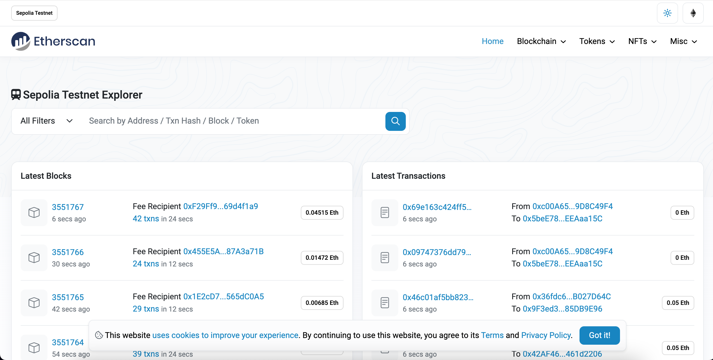
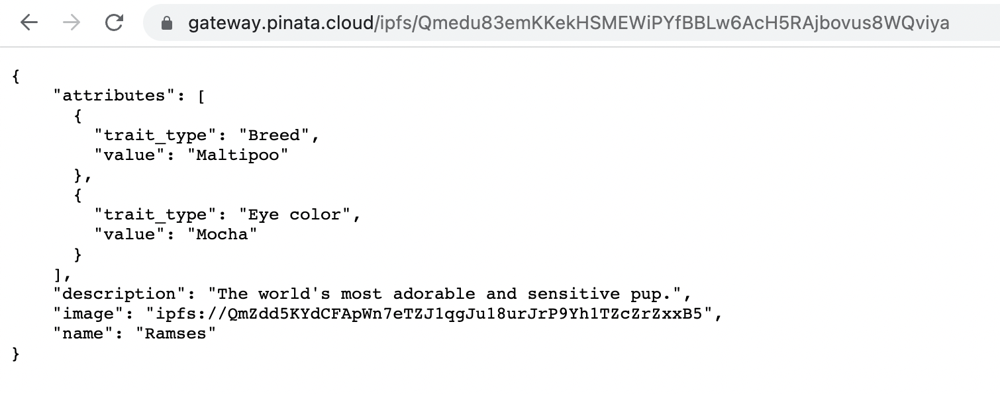
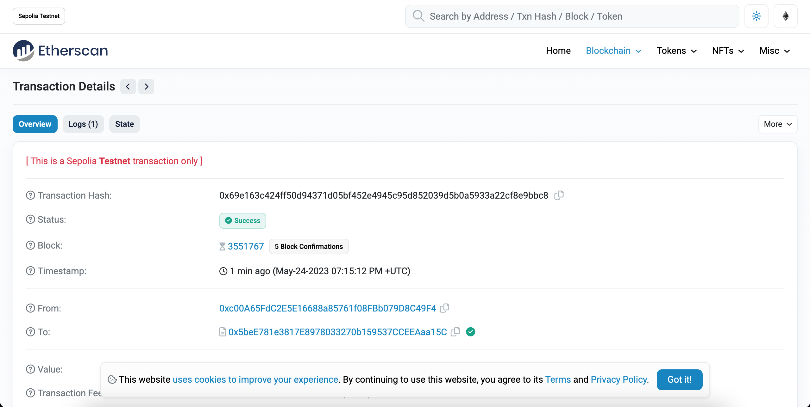

“Minting an NFT” is the act of publishing a unique instance of your ERC-721 token on the blockchain. Using our smart contract from [Part 1 of this NFT tutorial series](/developers/tutorials/how-to-write-and-deploy-an-nft/), let’s flex our Web3 skills and mint an NFT. At the end of this tutorial, you’ll be able to mint as many NFTs as your heart (and wallet) desires!

Let’s get started!

## Step 1: Check your setup {#install-web3}

If you followed the first tutorial on creating your NFT smart contract, you already have everything you need: a Hardhat 3 project with the [Ethers plugin](https://hardhat.org/docs/plugins/hardhat-ethers) and [ethers.js](https://docs.ethers.org/v6/), a library used to make creating requests to the [Ethereum](/) blockchain easier. We’ll write our minting code as a Hardhat script, so it reuses the Sepolia network settings and the `API_URL` and `PRIVATE_KEY` values from Part 1 — there’s nothing new to install.

## Step 2: Create a `mint-nft.js` file {#create-mintnftjs}

Inside your scripts directory, create a `mint-nft.js` file and add the following lines of code:

```js
import { network } from "hardhat"

const { ethers } = await network.create()
```

As in our deploy script, `network.create()` connects to the network you choose with `--network` when you run the script, and gives us an `ethers` object for it.

## Step 3: Grab your contract ABI {#contract-abi}

Our contract ABI (Application Binary Interface) is the interface to interact with our smart contract. You can learn more about [contract ABIs](/glossary/#abi). Hardhat automatically generates an ABI for us when it compiles the contract and saves it in the `artifacts/contracts/MyNFT.sol/MyNFT.json` file. The Hardhat Ethers plugin reads it from there for us when we create our contract instance in step 5, so we don't need to load it ourselves.

If you want to see the ABI you can print it to your console. From your project's root directory, run:

```sh
node -p "JSON.stringify(require('./artifacts/contracts/MyNFT.sol/MyNFT.json').abi)"
```

## Step 4: Configure the metadata for your NFT using IPFS {#config-meta}

If you remember from our tutorial in Part 1, our `mintNFT` smart contract function takes in a tokenURI parameter that should resolve to a JSON document describing the NFT's metadata— which is really what brings the NFT to life, allowing it to have configurable properties, such as a name, description, image, and other attributes.

> _Interplanetary File System (IPFS) is a decentralized protocol and peer-to-peer network for storing and sharing data in a distributed file system._

We will use Pinata, a convenient IPFS API and toolkit, to store our NFT asset and metadata to ensure our NFT is truly decentralized. If you don’t have a Pinata account, sign up for a free account [here](https://app.pinata.cloud) and complete the steps to verify your email.

Once you’ve created an account:

- Navigate to the [Files page](https://app.pinata.cloud/ipfs/files) and click the "Add" button in the top right corner of the page.

- Upload an image to Pinata — this will be the image asset for your NFT. Feel free to name the asset whatever you wish. Make sure you upload it to public IPFS: files on [Private IPFS](https://docs.pinata.cloud/files/private-ipfs) can't be fetched by wallets and marketplaces that display your NFT.

- After you upload, you'll see the file listed on the Files page together with its CID (content identifier). Copy the CID. You can view your upload at: `https://gateway.pinata.cloud/ipfs/<CID>`, or through the dedicated gateway listed under "Gateways" in the Pinata sidebar. You can find the image we used on IPFS [here](https://gateway.pinata.cloud/ipfs/QmZdd5KYdCFApWn7eTZJ1qgJu18urJrP9Yh1TZcZrZxxB5), for example.

Now, we’re going to want to upload one more document to Pinata. But before we do that, we need to create it!

In your root directory, make a new file called `nft-metadata.json` and add the following json code:

```json
{
  "attributes": [
    {
      "trait_type": "Breed",
      "value": "Maltipoo"
    },
    {
      "trait_type": "Eye color",
      "value": "Mocha"
    }
  ],
  "description": "The world's most adorable and sensitive pup.",
  "image": "ipfs://QmWmvTJmJU3pozR9ZHFmQC2DNDwi2XJtf3QGyYiiagFSWb",
  "name": "Ramses"
}
```

Feel free to change the data in the json. You can remove or add to the attributes section. Most importantly, make sure the image field points to the location of your IPFS image, in the form `ipfs://<image-CID>` — otherwise, your NFT will include a photo of a (very cute!) dog.

Once you’re done editing the JSON file, save it and upload it to Pinata, following the same steps we did for uploading the image. Copy the CID of `nft-metadata.json` too; we'll need it in step 9.

## Step 5: Create an instance of your contract {#instance-contract}

Now, to interact with our contract, we need to create an instance of it in our code. To do so we'll need our contract address, which our deploy script printed in Part 1. You can also find it on [Etherscan](https://sepolia.etherscan.io/) or [Blockscout](https://eth-sepolia.blockscout.com/) by looking up the address you used to deploy the contract.



In the above example, our contract address is 0x5a738a5c5fe46a1fd5ee7dd7e38f722e2aef7778.

Next we will use the Hardhat Ethers plugin's `getContractAt` method to create our contract using its name (which tells it which ABI to use) and its address. In your `mint-nft.js` file, add the following, replacing the address with your own:

```js
const contractAddress = "0x5a738a5c5fe46a1fd5ee7dd7e38f722e2aef7778"
const nftContract = await ethers.getContractAt("MyNFT", contractAddress)
```

## Step 6: Check the `.env` file {#update-env}

Every transaction we send has to be signed with your account's private key. If you completed part 1 of the tutorial, our `.env` file should already look like this:

```text
API_URL="https://eth-sepolia.g.alchemy.com/v2/your-api-key"
PRIVATE_KEY="your-metamask-private-key"
```

There's no need to add your public address: ethers works it out from the private key.

## Step 7: Create your transaction {#create-txn}

First, let’s define a function named `mintNFT(tokenURI)` and create our transaction by doing the following:

1. Get the account we send the transaction from. `ethers.getSigners()` returns the accounts configured for the network, which on Sepolia is the account whose private key is in `.env`. Since `mintNFT` is `onlyOwner`, this must be the same account that deployed the contract.

1. Call the `mintNFT` function on our contract instance, with our own address as the recipient and the metadata URI. This is the computation we wish to perform in this transaction — which in this case is minting an NFT.

You don't need to work out the nonce (the number of transactions sent from your address, which prevents replay attacks), the gas limit, or the fees yourself: ethers fetches or estimates them before sending the transaction.

Your `mint-nft.js` file should look like this now:

```js
import { network } from "hardhat"

const { ethers } = await network.create()

const contractAddress = "0x5a738a5c5fe46a1fd5ee7dd7e38f722e2aef7778"
const nftContract = await ethers.getContractAt("MyNFT", contractAddress)

async function mintNFT(tokenURI) {
  const [signer] = await ethers.getSigners()

  // Send the transaction. ethers fills in the nonce, gas limit and fees for us.
  const tx = await nftContract.mintNFT(signer.address, tokenURI)
}
```

## Step 8: Sign the transaction {#sign-txn}

Because the network is configured with our private key, ethers signs the transaction with it automatically before sending it.

Calling `mintNFT` returns once the transaction has been sent, and gives us the transaction hash, which we can use to make sure our transaction was mined and didn't get dropped by the network. `tx.wait()` then waits until the transaction is included in a block. We've also added some error checking so we know if our transaction successfully went through.

```js
import { network } from "hardhat"

const { ethers } = await network.create()

const contractAddress = "0x5a738a5c5fe46a1fd5ee7dd7e38f722e2aef7778"
const nftContract = await ethers.getContractAt("MyNFT", contractAddress)

async function mintNFT(tokenURI) {
  const [signer] = await ethers.getSigners()

  try {
    // Send the transaction. ethers fills in the nonce, gas limit and fees for us.
    const tx = await nftContract.mintNFT(signer.address, tokenURI)
    console.log("The hash of your transaction is:", tx.hash)

    // Wait for the transaction to be included in a block
    const receipt = await tx.wait()
    console.log("Your NFT was minted in block", receipt.blockNumber)
  } catch (err) {
    console.log("Something went wrong when submitting your transaction:", err)
  }
}
```

## Step 9: Call `mintNFT` and run `mint-nft.js` {#call-mintnft-fn}

Remember the `nft-metadata.json` you uploaded to Pinata? Get its CID from Pinata and pass `ipfs://<metadata-CID>` as the parameter to the function `mintNFT`. Wallets and marketplaces resolve `ipfs://` URIs through an IPFS gateway of their choice, so your NFT doesn't depend on any single gateway.

> Double check that the CID you copied links to your **nft-metadata.json** by loading `https://gateway.pinata.cloud/ipfs/<metadata-CID>` into a separate window. The page should look similar to the screenshot below:

_Your page should display the json metadata_

Altogether, your code should look something like this:

```js
import { network } from "hardhat"

const { ethers } = await network.create()

const contractAddress = "0x5a738a5c5fe46a1fd5ee7dd7e38f722e2aef7778"
const nftContract = await ethers.getContractAt("MyNFT", contractAddress)

async function mintNFT(tokenURI) {
  const [signer] = await ethers.getSigners()

  try {
    // Send the transaction. ethers fills in the nonce, gas limit and fees for us.
    const tx = await nftContract.mintNFT(signer.address, tokenURI)
    console.log("The hash of your transaction is:", tx.hash)

    // Wait for the transaction to be included in a block
    const receipt = await tx.wait()
    console.log("Your NFT was minted in block", receipt.blockNumber)
  } catch (err) {
    console.log("Something went wrong when submitting your transaction:", err)
  }
}

await mintNFT("ipfs://QmYueiuRNmL4MiA2GwtVMm6ZagknXnSpQnB3z2gWbz36hP")
```

Now, run the script against Sepolia to mint your NFT:

```sh
npx hardhat run scripts/mint-nft.js --network sepolia
```

After a few seconds, you should see a response like this in your terminal:

```text
The hash of your transaction is: 0x301791fdf492001fcd9d5e5b12f3aa1bbbea9a88ed24993a8ab2cdae2d06e1e8
Your NFT was minted in block <block number>
```

To see the details of your transaction, search for its hash on [Etherscan](https://sepolia.etherscan.io/) or [Blockscout](https://eth-sepolia.blockscout.com/).

_View your NFT transaction hash on Etherscan_

And that’s it! You’ve now deployed AND minted with a NFT on the Ethereum blockchain <Emoji text=":money_mouth_face:" size={1} />

Using the `mint-nft.js` you can mint as many NFTs as your heart (and wallet) desires! Just be sure to pass in a new tokenURI describing the NFT's metadata (otherwise, you'll just end up making a bunch of identical ones with different IDs).

Presumably, you’d like to be able to show off your NFT in your wallet — so be sure to check out [Part 3: How to View Your NFT in Your Wallet](/developers/tutorials/how-to-view-nft-in-metamask/)!
