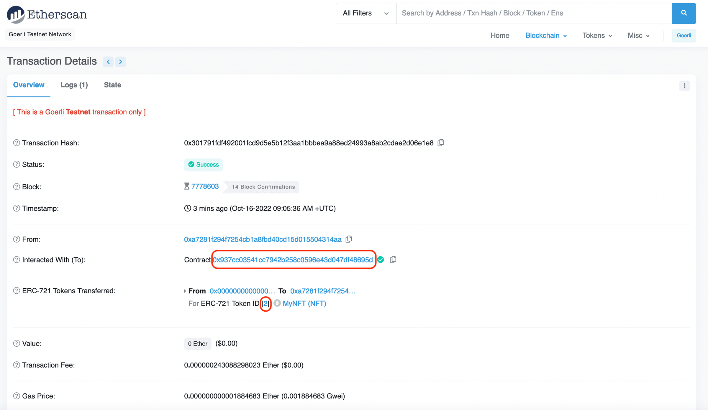

This tutorial is Part 3/3 in the NFT Tutorial series, where we view our newly minted NFT. However, you can use the general tutorial for any ERC-721 token using MetaMask, including on Mainnet or any testnet. If you’d like to learn how to mint your own NFT on Ethereum, you should check out [Part 1 on How to Write & Deploy an NFT smart contract](/developers/tutorials/how-to-write-and-deploy-an-nft)!

Congrats! You’ve made it to the shortest and simplest part of our NFT tutorial series — how to view your freshly minted NFT on a virtual wallet. We’ll be using MetaMask for this example since it is what we used in the previous two parts.

As a prerequisite, you should already have MetaMask installed, either the browser extension or the mobile app, and it should include the account to which you minted your NFT. You can get MetaMask for free from the [MetaMask download page](https://metamask.io/download).

## Step 1: Set your network to Sepolia {#set-network-to-sepolia}

As our NFT was minted on the Sepolia test network, you’ll want to select Sepolia as your network. MetaMask hides test networks by default, so first turn them on:

1. Open the menu in the top right corner and select "Networks".
2. Scroll down to the bottom of the network list and toggle "Show test networks" on.
3. Select "Sepolia" from the network list.

See [MetaMask's guide to viewing testnets](https://support.metamask.io/configure/networks/how-to-view-testnets-in-metamask/) if the menus look different in your version of MetaMask.

## Step 2: Add your collectable to MetaMask {#add-nft-to-metamask}

MetaMask detects NFTs automatically only on some networks, which don’t include Sepolia, so you’ll need to import your NFT manually. For that you need the NFT smart contract address and the ERC-721 token ID of your NFT — which you should be able to find on Etherscan based on the transaction hash from your NFT minted in Part II of our tutorial. If you used the contract from Part 1, your first NFT has token ID 1.

Then, in MetaMask (extension or mobile):

1. Go to the "NFTs" section of the home screen and select "Import NFT".
2. Select Sepolia as the network, and paste your NFT smart contract address into the "Address" box.
3. Enter your token ID into the "Token ID" box and select "Import".

You may need to refresh a couple times to view your NFT — but it will be there <Emoji text="😄" size={1} />! If MetaMask says you are not the owner of the NFT, check that you selected the account you minted the NFT to. For more help, see [MetaMask's guide to NFTs](https://support.metamask.io/manage-crypto/nfts/nft-tokens-in-your-metamask-wallet/).

Congrats! You have successfully minted an NFT, and you can now view it! We can’t wait to see how you’ll take the NFT world by storm!
