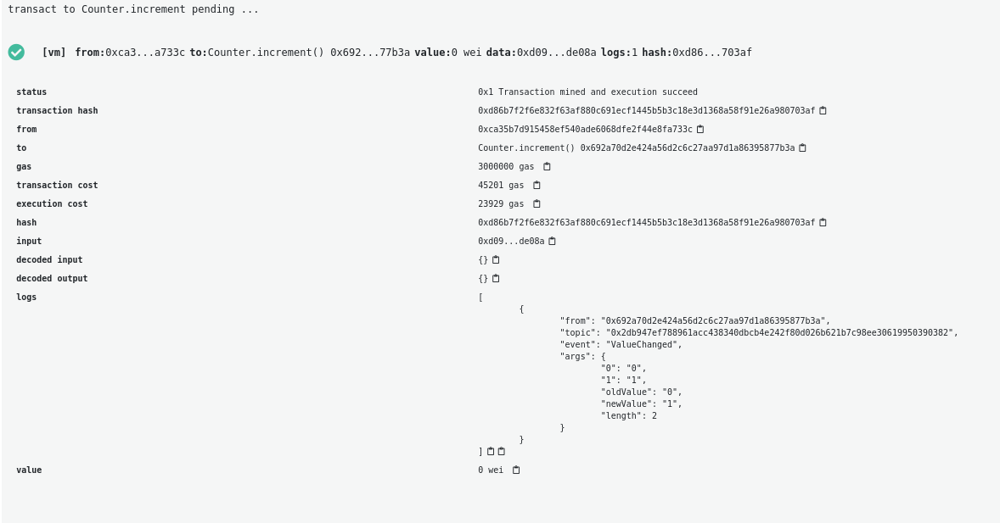

In Solidity, [events](/developers/docs/smart-contracts/anatomy/#events-and-logs) are dispatched signals the smart contracts can fire. Dapps, or anything connected to Ethereum JSON-RPC API, can listen to these events and act accordingly. An event can also be indexed so that the event history is searchable later.

## Events {#events}

One of the most common events on the Ethereum blockchain is the `Transfer` event that is emitted by ERC-20 tokens when someone transfers tokens.

```solidity
event Transfer(address indexed from, address indexed to, uint256 value);
```

The event signature is declared inside of the contract code and can be emitted with the emit keyword. For example, the transfer event logs who sent the transfer (_from_), to who (_to_) and how much tokens were transferred (_value_).

Let’s get back to the `Counter` smart contract from [deploying your first smart contract](/developers/tutorials/deploying-your-first-smart-contract/) and log every time the value is changed. It would look like this:

```solidity
// SPDX-License-Identifier: MIT
pragma solidity ^0.8.24;

contract Counter {

    event ValueChanged(uint256 oldValue, uint256 newValue);

    // Public variable of type unsigned int to keep the number of counts
    uint256 public count = 0;

    // Function that increments our counter
    function increment() public {
        count += 1;
        emit ValueChanged(count - 1, count);
    }

    // Not necessary getter to get the count value
    function getCount() public view returns (uint256) {
        return count;
    }

}
```

Notice that:

- **Line 6**: we declare our event and what it contains, the old value and the new value.

- **Line 14**: When we increment our count variable, we emit the event.

If we now deploy the contract and call the increment function, we’ll see that Remix will automatically display it if you click on the new transaction inside an array named logs.



Logs are really useful for debugging your smart contracts but they are also important if you build applications used by different people and make it easier to make analytics to track and understand how your smart contract is used. The logs generated by transactions are displayed in popular block explorers and you can also for example use them to create offchain scripts for listening to specific events and taking action when they occur.
