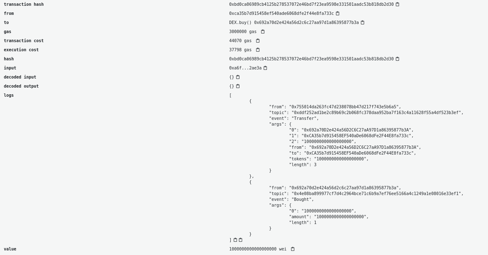
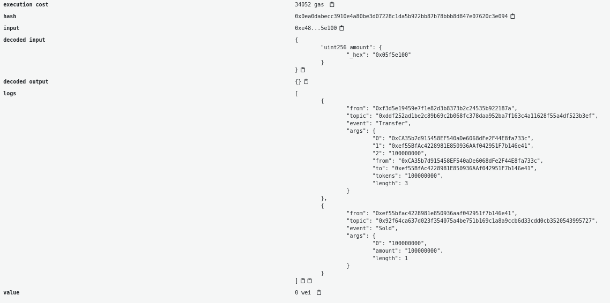

In the previous tutorial we studied [the anatomy of an ERC-20 token in Solidity](/developers/tutorials/erc20-annotated-code/) on the Ethereum blockchain. In this article we’ll see how we can use a smart contract to interact with a token using the Solidity language.

For this smart contract, we’ll create a real dummy decentralized exchange where a user can trade ether for our newly deployed [ERC-20 token](/developers/docs/standards/tokens/erc-20/).

For this tutorial we’ll use a minimal ERC-20 implementation as a base. Our DEX will instantiate an instance of the contract in its constructor and perform the operations of:

- exchanging tokens to ether
- exchanging ether to tokens

We’ll start our Decentralized exchange code by adding our simple ERC20 codebase:

```solidity
// SPDX-License-Identifier: MIT
pragma solidity ^0.8.24;

interface IERC20 {

    function totalSupply() external view returns (uint256);
    function balanceOf(address account) external view returns (uint256);
    function allowance(address owner, address spender) external view returns (uint256);

    function transfer(address recipient, uint256 amount) external returns (bool);
    function approve(address spender, uint256 amount) external returns (bool);
    function transferFrom(address sender, address recipient, uint256 amount) external returns (bool);


    event Transfer(address indexed from, address indexed to, uint256 value);
    event Approval(address indexed owner, address indexed spender, uint256 value);
}


contract ERC20Basic is IERC20 {

    string public constant name = "ERC20Basic";
    string public constant symbol = "ERC";
    uint8 public constant decimals = 18;


    mapping(address => uint256) balances;

    mapping(address => mapping (address => uint256)) allowed;

    uint256 totalSupply_ = 10 ether;


    constructor() {
        balances[msg.sender] = totalSupply_;
    }

    function totalSupply() public override view returns (uint256) {
        return totalSupply_;
    }

    function balanceOf(address tokenOwner) public override view returns (uint256) {
        return balances[tokenOwner];
    }

    function transfer(address receiver, uint256 numTokens) public override returns (bool) {
        require(numTokens <= balances[msg.sender]);
        balances[msg.sender] = balances[msg.sender]-numTokens;
        balances[receiver] = balances[receiver]+numTokens;
        emit Transfer(msg.sender, receiver, numTokens);
        return true;
    }

    function approve(address delegate, uint256 numTokens) public override returns (bool) {
        allowed[msg.sender][delegate] = numTokens;
        emit Approval(msg.sender, delegate, numTokens);
        return true;
    }

    function allowance(address owner, address delegate) public override view returns (uint) {
        return allowed[owner][delegate];
    }

    function transferFrom(address owner, address buyer, uint256 numTokens) public override returns (bool) {
        require(numTokens <= balances[owner]);
        require(numTokens <= allowed[owner][msg.sender]);

        balances[owner] = balances[owner]-numTokens;
        allowed[owner][msg.sender] = allowed[owner][msg.sender]-numTokens;
        balances[buyer] = balances[buyer]+numTokens;
        emit Transfer(owner, buyer, numTokens);
        return true;
    }
}


```

Our new DEX smart contract will deploy the ERC-20 and get all the supply:

```solidity
contract DEX {

    IERC20 public token;

    event Bought(uint256 amount);
    event Sold(uint256 amount);

    constructor() {
        token = new ERC20Basic();
    }

    function buy() payable public {
        // TODO
    }

    function sell(uint256 amount) public {
        // TODO
    }

}
```

So we now have our DEX and it has all the token reserve available. The contract has two functions:

- `buy`: The user can send ether and get tokens in exchange
- `sell`: The user can decide to send tokens to get ether back

## The buy function {#the-buy-function}

Let’s code the buy function. We’ll first need to check the amount of ether the message contains and verify that the contracts own enough tokens and that the message has some ether in it. If the contract owns enough tokens it’ll send the number of tokens to the user and emit the `Bought` event.

Note that if we call the require function in the case of an error the ether sent will directly be reverted and given back to the user.

To keep things simple, we exchange 1 token base unit for 1 wei. As the token has 18 decimals, like ether, sending 1 ether buys exactly 1 token.

```solidity
function buy() payable public {
    uint256 amountTobuy = msg.value;
    uint256 dexBalance = token.balanceOf(address(this));
    require(amountTobuy > 0, "You need to send some ether");
    require(amountTobuy <= dexBalance, "Not enough tokens in the reserve");
    require(token.transfer(msg.sender, amountTobuy), "Token transfer failed");
    emit Bought(amountTobuy);
}
```

In the case where the buy is successful we should see two events in the transaction: The token `Transfer` and the `Bought` event.



## The sell function {#the-sell-function}

The function responsible for the sell will first require the user to have approved the amount by calling the approve function beforehand. Approving the transfer requires the ERC20Basic token instantiated by the DEX to be called by the user. This can be achieved by first calling the DEX contract's `token()` function to retrieve the address where DEX deployed the ERC20Basic contract called `token`. Then we call its `approve` function. Then we are able to call the DEX's `sell` function and swap our tokens back for ether.

In Remix, copy the address returned by `token()`, select `ERC20Basic` in the contract list of the Deploy & Run panel, paste the address into **At Address** and call `approve` from there. From the command line, you can do the same with [Foundry](https://getfoundry.sh/introduction/installation): save the complete code at the end of this tutorial as `src/DEX.sol` in a new project (`forge init dex`), then start a local development chain in a separate terminal:

```sh
anvil
```

Anvil prints a list of funded test accounts and their private keys. Use two of them to deploy the DEX, buy tokens and approve the DEX to spend them:

```sh
export RPC_URL=http://127.0.0.1:8545
export ACCOUNT1_KEY=<private key (0) printed by anvil>
export ACCOUNT2_KEY=<private key (1) printed by anvil>

# deploy the DEX
forge create src/DEX.sol:DEX --rpc-url $RPC_URL --private-key $ACCOUNT1_KEY --broadcast

# copy the "Deployed to" address from the output above
export DEX=<DEX contract address>

# call the buy function to swap ether for tokens
# 1ether is 10^18 wei, so this buys 1 full token
cast send $DEX "buy()" --value 1ether --rpc-url $RPC_URL --private-key $ACCOUNT2_KEY

# get the deployment address for the ERC20 token
# that was deployed during DEX contract creation
export TOKEN=$(cast call $DEX "token()(address)" --rpc-url $RPC_URL)

# call the token's approve function
# approve the dex address as spender
# and how many of your tokens it is allowed to spend
cast send $TOKEN "approve(address,uint256)" $DEX 1ether --rpc-url $RPC_URL --private-key $ACCOUNT2_KEY
```

Then when the sell function is called, we’ll check if the transfer from the caller address to the contract address was successful and then send the Ethers back to the caller address. The ether is sent last, after all checks and state changes, following the [checks-effects-interactions pattern](https://docs.soliditylang.org/en/latest/security-considerations.html#use-the-checks-effects-interactions-pattern). We send it with a low-level `call` and check that it succeeded, as `transfer` is deprecated in recent versions of Solidity.

```solidity
function sell(uint256 amount) public {
    require(amount > 0, "You need to sell at least some tokens");
    uint256 allowance = token.allowance(msg.sender, address(this));
    require(allowance >= amount, "Check the token allowance");
    require(token.transferFrom(msg.sender, address(this), amount), "Token transfer failed");
    emit Sold(amount);
    (bool sent, ) = payable(msg.sender).call{value: amount}("");
    require(sent, "Failed to send ether");
}
```

With Foundry, the swap back looks like this:

```sh
cast send $DEX "sell(uint256)" 1ether --rpc-url $RPC_URL --private-key $ACCOUNT2_KEY

# check the balances of the second account
export ACCOUNT2=$(cast wallet address --private-key $ACCOUNT2_KEY)
cast call $TOKEN "balanceOf(address)(uint256)" $ACCOUNT2 --rpc-url $RPC_URL
cast balance $ACCOUNT2 --ether --rpc-url $RPC_URL
```

If everything works you should see 2 events (a `Transfer` and `Sold`) in the transaction and your token balance and ether balance updated.



<Divider />

From this tutorial we saw how to check the balance and allowance of an ERC-20 token and also how to call `Transfer` and `TransferFrom` of an ERC20 smart contract using the interface.

Note that the DEX checks the `bool` returned by `transfer` and `transferFrom`. Some tokens in the wild do not follow the standard exactly and return nothing; when your contract must work with arbitrary ERC-20 tokens, use a wrapper such as OpenZeppelin's [SafeERC20](https://docs.openzeppelin.com/contracts/5.x/api/token/erc20#SafeERC20).

Once you make a transaction, you can use a JavaScript library like viem to [wait for the transaction to be included in a block](https://viem.sh/docs/actions/public/waitForTransactionReceipt) and to [decode the events](https://viem.sh/docs/contract/parseEventLogs) generated by token transfers or any other events, as long as you have the ABI. See also [logging data from smart contracts with events](/developers/tutorials/logging-events-smart-contracts/).

Here is the complete code for the tutorial:

```solidity
// SPDX-License-Identifier: MIT
pragma solidity ^0.8.24;

interface IERC20 {

    function totalSupply() external view returns (uint256);
    function balanceOf(address account) external view returns (uint256);
    function allowance(address owner, address spender) external view returns (uint256);

    function transfer(address recipient, uint256 amount) external returns (bool);
    function approve(address spender, uint256 amount) external returns (bool);
    function transferFrom(address sender, address recipient, uint256 amount) external returns (bool);


    event Transfer(address indexed from, address indexed to, uint256 value);
    event Approval(address indexed owner, address indexed spender, uint256 value);
}


contract ERC20Basic is IERC20 {

    string public constant name = "ERC20Basic";
    string public constant symbol = "ERC";
    uint8 public constant decimals = 18;


    mapping(address => uint256) balances;

    mapping(address => mapping (address => uint256)) allowed;

    uint256 totalSupply_ = 10 ether;


    constructor() {
        balances[msg.sender] = totalSupply_;
    }

    function totalSupply() public override view returns (uint256) {
        return totalSupply_;
    }

    function balanceOf(address tokenOwner) public override view returns (uint256) {
        return balances[tokenOwner];
    }

    function transfer(address receiver, uint256 numTokens) public override returns (bool) {
        require(numTokens <= balances[msg.sender]);
        balances[msg.sender] = balances[msg.sender]-numTokens;
        balances[receiver] = balances[receiver]+numTokens;
        emit Transfer(msg.sender, receiver, numTokens);
        return true;
    }

    function approve(address delegate, uint256 numTokens) public override returns (bool) {
        allowed[msg.sender][delegate] = numTokens;
        emit Approval(msg.sender, delegate, numTokens);
        return true;
    }

    function allowance(address owner, address delegate) public override view returns (uint) {
        return allowed[owner][delegate];
    }

    function transferFrom(address owner, address buyer, uint256 numTokens) public override returns (bool) {
        require(numTokens <= balances[owner]);
        require(numTokens <= allowed[owner][msg.sender]);

        balances[owner] = balances[owner]-numTokens;
        allowed[owner][msg.sender] = allowed[owner][msg.sender]-numTokens;
        balances[buyer] = balances[buyer]+numTokens;
        emit Transfer(owner, buyer, numTokens);
        return true;
    }
}


contract DEX {

    event Bought(uint256 amount);
    event Sold(uint256 amount);


    IERC20 public token;

    constructor() {
        token = new ERC20Basic();
    }

    function buy() payable public {
        uint256 amountTobuy = msg.value;
        uint256 dexBalance = token.balanceOf(address(this));
        require(amountTobuy > 0, "You need to send some ether");
        require(amountTobuy <= dexBalance, "Not enough tokens in the reserve");
        require(token.transfer(msg.sender, amountTobuy), "Token transfer failed");
        emit Bought(amountTobuy);
    }

    function sell(uint256 amount) public {
        require(amount > 0, "You need to sell at least some tokens");
        uint256 allowance = token.allowance(msg.sender, address(this));
        require(allowance >= amount, "Check the token allowance");
        require(token.transferFrom(msg.sender, address(this), amount), "Token transfer failed");
        emit Sold(amount);
        (bool sent, ) = payable(msg.sender).call{value: amount}("");
        require(sent, "Failed to send ether");
    }

}
```
